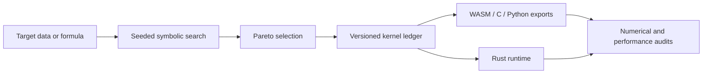

# SPEAR Lab

**Symbolic Pareto Evolutionary Algorithm for Research**

[](https://www.npmjs.com/package/spear-kernels) [](LICENSE)

SPEAR is an open-source symbolic regression engine that searches for interpretable mathematical expressions and exports numerical kernels to WebAssembly, C99 and Python/PyTorch. Its research workflow emphasizes reproducible seeds, numerical accuracy and explicit performance trade-offs.

[Project website](https://bahira.github.io/superspear/) · [npm package](https://www.npmjs.com/package/spear-kernels) · [Full research reference](RESEARCH-REFERENCE.md)

## What it does

- Evolves mathematical expressions using seeded genetic programming and Pareto optimization.
- Tracks accuracy and computational cost in a versioned per-task ledger.
- Exports kernels with cross-runtime numerical checks.
- Provides a Rust implementation and an MCP interface for agent integration.

## Quick start

```sh
npm install spear-kernels
```

For source development, dashboard setup, MCP configuration and detailed validation commands, see the [full research reference](RESEARCH-REFERENCE.md#getting-started).

## Architecture



## Research evidence

| Area | Evidence |
| --- | --- |
| Symbolic discovery | [Research campaigns and Hall of Fame](RESEARCH-REFERENCE.md#-hall-of-fame) |
| Kernel validation | [C export and parity methodology](RESEARCH-REFERENCE.md#the-misra-c-export-pipeline) |
| Reproducibility | [Seeded replay instructions](RESEARCH-REFERENCE.md#reproducibility) |
| Native performance | [Rust benchmarks](spear-rs/BENCH.md) |
| Agent integration | [MCP setup](RESEARCH-REFERENCE.md#-mcp-server--use-spear-from-claude-cursor--any-llm-agent) |

The documented research snapshot reports 90 registered tasks and 42 exact solves under its MSE threshold. These are benchmark-specific results, not guarantees of generalization. Operation-count estimates, measured wall-clock timings and comparisons against iterative algorithms must be interpreted separately.

## Limitations

- Accuracy is evaluated on specified benchmark domains; extrapolation is not guaranteed.
- Fast approximations trade accuracy for computational cost.
- Speedups depend on the baseline, hardware, implementation and workload.
- Export lint and sampled parity checks do not constitute formal safety certification.

See the [complete methodology and limitations](RESEARCH-REFERENCE.md#honesty-notes) before using kernels in production or safety-critical systems.

## Project layout

| Path | Purpose |
| --- | --- |
| `ledger/` | Versioned kernel records |
| `src/lib/spear/` | Search engine, task definitions and code generation |
| `src/mcp/` | MCP stdio server |
| `scripts/` | Research, export and validation scripts |
| `spear-rs/` | Rust runtime, emitter and benchmarks |
| `docs/` | Project website |

## License

[MIT](LICENSE). See the [research reference](RESEARCH-REFERENCE.md) for provenance and funding information.
